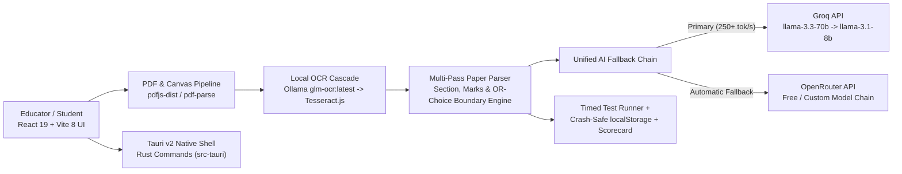

# 🎯 Examiner.AI (v2.0 / Tauri Desktop & Web)

> **Transform any CBSE/Board exam paper PDF or scanned image into a timed, interactive practice test with board-style AI grading, diagram display, and step-wise feedback.**

Examiner.AI is a client-first **React 19 + TypeScript + Vite 8** application wrapped in a native **Rust / Tauri v2** desktop shell (`src-tauri/`). It pairs a local **Ollama (`glm-ocr:latest`) + Tesseract.js + `pdfjs-dist`** extraction pipeline with a **Groq -> OpenRouter** multi-provider fallback chain to structure question papers and run dual-pass CBSE-aligned step marking.

---

## 🏗️ System Architecture



For subsystem interfaces and pipeline internals, see [ARCHITECTURE.md](./ARCHITECTURE.md).

---

## ✨ Key Capabilities

1. **Unified Multi-Client Fallback Chain (`src/lib/extractor/groq-client.ts`)**
   - **Primary (Groq):** `llama-3.3-70b-versatile` with instant fallback to `llama-3.1-8b-instant`.
   - **Secondary (OpenRouter):** Automatic failover if Groq is unconfigured or rate-limited (`OPENROUTER_API_KEY`).
   - **Offline OCR (`src-tauri/src/commands/ollama.rs` & `ocr_extractor.ts`):** Managed local Ollama `glm-ocr:latest` invocation and `tesseract.js` fallback.
2. **Multi-Pass Layout Extraction & Local Normalization (`src/lib/extractor/local/`)**
   - Separates document headers, `OR` choice branches, mark allocations, and appended solutions.
3. **Interactive Timed Practice & Step-Wise Grading**
   - Auto-pauses on tab switch (`visibilitychange`), crash-recovers drafts via storage, embeds the interactive Dino strike preloader, and evaluates responses with partial-credit CBSE rubrics.

---

## 🚀 Quick Start

### Prerequisites
- **Node.js** 18+ and **npm**
- **Rust / Cargo** (optional, required only for `npm run tauri:dev` / `npm run tauri:build`)
- **Ollama** (optional, for local `glm-ocr:latest` scanned OCR)

### 1. Configure Environment & Install
```bash
cp .env.example .env
# Add GROQ_API_KEY and/or OPENROUTER_API_KEY in .env
npm install
```

### 2. Verify & Run
```bash
# Typecheck + production Vite bundle
npm run typecheck
npm run build

# Launch web dev server
npm run dev

# Or launch native Rust/Tauri desktop shell
npm run tauri:dev
```

---

## 📂 Project Structure

```text
ExaminerAI/
├── src/
│   ├── pages/               # HomePage, MyPapersPage, TestPage, ResultsPage, SettingsPage
│   ├── components/          # UI modules (dino-game, home-dashboard, test-experience, question-palette, etc.)
│   └── lib/
│       └── extractor/       # groq-client, ocr_extractor, pdf-extractor, text-extractor, local/*
├── src-tauri/               # Native Rust Tauri v2 desktop wrapper + Ollama commands
│   ├── src/commands/        # ollama.rs command handlers
│   ├── Cargo.toml
│   └── tauri.conf.json
├── public/                  # Offline pdf.worker.min.mjs worker
├── .env.example             # Environment variable template (GROQ / OPENROUTER / OLLAMA)
├── ARCHITECTURE.md          # Engineering & due-diligence architecture overview
├── LICENSE.md               # Proprietary commercial evaluation license & carve-out
└── package.json
```

---

## 📄 Commercial Licensing & IP Acquisition

Copyright (c) 2026 Kushal (@onlykushalll). All Rights Reserved.  
Proprietary software asset available for commercial licensing, technical due diligence, and full IP acquisition — see [LICENSE.md](./LICENSE.md).

**Acquisition & Licensing Contact:** `creatormanager27@gmail.com` · GitHub: `https://github.com/onlykushalll`

### Third-Party Open-Source Carve-Out
Upstream frameworks and runtime dependencies (React, Vite, Tailwind CSS, Tauri v2, Rust crates, `pdfjs-dist`, `tesseract.js`, `lucide-react`, OpenAI Node SDK, and Ollama/GLM-OCR models) remain governed by their respective upstream open-source licenses.
